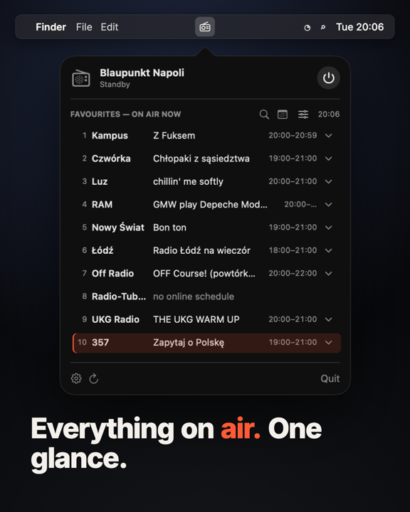

# FSAPI Radio Controller

A macOS menu bar app for internet radios built on **Frontier Silicon** modules, the radios you can control with the UNDOK app.
It adds what the remote and UNDOK lack: live schedules and playlists of your favourite stations, show descriptions, and planned listening.

English and Polish UI (follows the system language, can be switched in Settings).

[](docs/promo.mp4)

[Watch the 24-second demo (MP4)](docs/promo.mp4)

## Features

- **Menu bar control**: power, volume (1-step slider, ±, scroll over the icon), mute.
- **Favourites** (up to 10 of the radio's presets) with **what's on air now**, the next show and today's schedule.
- **Recently played tracks** per station, with a one-click YouTube search.
- **Show descriptions** (ⓘ next to a show).
- **Favourites schedule**: one timeline of all favourite stations for today and tomorrow. Tick a show and the radio turns itself on when it starts (needs the optional [scheduler](homelab/README.md) on an always-on machine).
- **Station search** in the radio's own catalogue, filtered by genre, played directly on the radio.
- **Save as preset**: store the playing station in any of the radio's preset slots.
- **Connection wizard**: finds radios on your network, checks the PIN.

Audio never plays on the Mac; everything happens on the radio.

## Compatible radios

The app speaks **FSAPI**, the HTTP API of Frontier Silicon (Frontier Smart) radio modules.
Rule of thumb: **if the UNDOK app can control your radio, this app should work too.**

Tested:

- Blaupunkt Napoli (module FS2340)

Expected to work (brands that ship Frontier Silicon modules in some models, not tested yet):
Roberts, Revo, Ruark, Tangent, Hama, Medion, Silvercrest, Grundig, Sangean, Lenco, auna, Majority, Bush, Denver, Imperial/Telestar, Dual, Sharp, Block, Pure, Panasonic.

Tried it with another radio? Please open an issue with the model and the module shown in **Settings → Radio** (e.g. `FS2340`), working or not.

Known limitation: **station search** walks the radio's catalogue menu by its labels and currently expects the radio's menu language to be **Polish**. Everything else is language independent.

## Stations with schedules

Schedules are matched by the **preset name** stored in the radio, so they work for anyone who has the station among their presets.

- **Radio Kampus** (Warsaw): schedule, playlist, show descriptions
- **Polskie Radio Czwórka**: schedule with hosts, playlist, show descriptions
- **Radio LUZ** (Wrocław): schedule with hosts, playlist, show descriptions
- **Radio RAM** (Wrocław): schedule with hosts, playlist, short notes
- **Radio Nowy Świat**: schedule with hosts, playlist, show descriptions
- **Radio Łódź**: schedule with segments
- **OFF Radio Kraków**: schedule with hosts, playlist, show descriptions
- **UKG Radio**: schedule, current track
- **Radio 357**: schedule with hosts, current track, show descriptions

Adding a station is one Swift file: implement `StationGuide` (`fetchSchedule(for:)`, optionally `fetchTracks()` and `fetchDescription(_:)`) in `Sources/Guides/` and register it with a name pattern in `GuideStore.registry`. Pull requests welcome.

## Install

### Download

Get the zipped app from [Releases](../../releases), unzip it and move it to Applications.
The app is not notarized: on first launch **right-click → Open** and confirm. If macOS still refuses:
`xattr -dr com.apple.quarantine "/Applications/FSAPI Radio Controller.app"`.

### Build from source

Requires macOS 12+ and the Xcode command line tools (`xcode-select --install`). No Xcode project is needed.

```bash
git clone https://github.com/pandawidkur/fsapi-radio-controller.git
cd fsapi-radio-controller
./build.sh              # builds, installs to ~/Applications and launches
./build.sh --no-install # only builds into build/
```

## First run

The settings window opens automatically:

1. **Search the network** lists the FSAPI radios found in your subnet. Click **Use**.
2. If the PIN is wrong, enter the radio's NetRemote PIN (radio menu: Settings → Network → NetRemote PIN, default `1234`).
3. Optional: **Scheduler** tab, see [homelab/README.md](homelab/README.md).

macOS asks for permission to access the local network. Allow it, otherwise the radio can't be found.

## How it works

- `FSAPIService` and `RadioCatalog` talk to the radio (`/fsapi/GET|SET|LIST_GET_NEXT`, one control session at a time).
- `PresetStore` reads the radio's presets (`netRemote.nav.presets`) and saves new ones (`netRemote.play.addPreset`).
- `GuideStore` plus `Sources/Guides/*` fetch schedules, playlists and descriptions from the stations' public websites and APIs.
- `PlanStore` syncs planned shows with `radio-scheduler` over HTTP or SSH.

Station data comes from the broadcasters' public pages and belongs to them; the app only displays it.

## License

MIT
